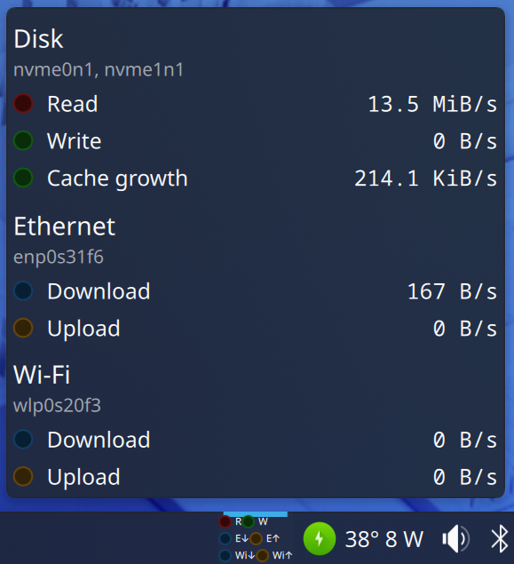

# Otter Blink



A KDE Plasma 6 panel widget, and now a Windows tray app, that shows disk and network activity as little blinking LEDs, like the ones on the front of an old tower case. Red for disk reads, green for disk writes, and optional network LEDs for receive and transmit. Click it for live transfer rates.

A companion to [Otter Power](https://github.com/MicahOttah/otter-power).

## Why another one?

I wanted a disk activity light. Just a light. Every applet I tried, including the one actually labeled "Indicator", turned out to be a graph. Graphs are great for spotting trends, but sometimes you just want to glance at the panel and see whether the drive is busy right now, the way you used to with the little LED on the front of the case.

So this is that: two dots that blink when something happens, plus a couple more for the network if you want them. No graphs. Not even a small one.

## Quick start (Linux)

```
git clone https://github.com/MicahOttah/otter-blink.git
cd otter-blink
bash install.sh
bash verify.sh
```

Then restart the panel and add the "Otter Blink" widget:

```
plasmashell --replace >/dev/null 2>&1 & disown
```

## Quick start (Windows)

1. Download `otter-blink-windows-VERSION.zip` from the Releases page.
2. Extract both files (`OtterBlink.exe` and `OtterBlink.exe.config`) into the same folder.
3. Run `OtterBlink.exe`.

Works on Windows 7 through 11 with nothing to install. See [Windows](#windows) below for details.

## Disclaimer

Unlike its sibling, this one is harmless. It only reads activity counters and never changes anything on your system. The worst it can do is blink at you.

Provided as is, with no warranty of any kind. See `LICENSE` for the formal terms.

## Tested on

- Dell Precision 7670, Fedora 44, KDE Plasma 6 on Wayland, kernel 7.2.x
- Lenovo ThinkPad T530 (Linux and Windows)
- Dell OptiPlex 7xxx Micro

No special hardware, drivers or software needed. On Linux it reads the standard `/proc` files every kernel provides; on Windows it uses the built-in performance counters and adapter statistics.

## What it does (Linux)

**Panel**

- Disk read and write LEDs, summed across the disks you choose
- Optional Ethernet and Wi-Fi LED pairs (receive and transmit), or one combined network pair to save space
- LEDs scale to fit the panel thickness, in a row, stacked pairs, or stacked groups
- Optional R, W, E, Wi and N labels
- Tooltip with one-second average rates

**Popup (left-click)**

- Live rates for every enabled LED, each with its own blinking indicator
- The devices and interfaces each section is counting, so you can check your filters

**Configure (right-click)**

- General: colors, off brightness, LED size, spacing, layout, labels, poll interval, blink duration
- Disk: show or hide, device filter (regex), and what the write LED tracks
- Network: show or hide Ethernet and Wi-Fi, interface filters (regex), combine into one pair, and a threshold to ignore background chatter

## Why the write LED sometimes looks lazy

Linux doesn't write to disk the moment a program saves data. Writes land in RAM (the page cache) and get flushed in batches every few seconds, and Btrfs commits every 30 seconds by default. During a big copy you will see quiet gaps and then a hard flash.

The Disk page has a setting for this:

- **Physical disk writes only**: what the drive actually does
- **Cache writes only**: lights when unwritten data in RAM is growing
- **Both** (default): either one lights the LED

The kernel only refreshes its cache counter about once per second, so cache mode pulses at roughly that rate.

## How it measures (Linux)

| Source | Used for |
| --- | --- |
| `/proc/diskstats` | Sectors read and written (always 512-byte units) |
| `/proc/net/dev` | Bytes received and transmitted per interface |
| `/proc/meminfo` | The `Dirty` counter for cache mode |

The default disk filter matches whole physical disks (`sd`, `hd`, `vd`, `nvme`, `mmcblk`) and skips partitions, device mapper volumes and zram, so nothing is counted twice. The default interface filters match names starting with `en` or `eth` (Ethernet) and `wl` or `wlan` (Wi-Fi). Run `ip -br link` to see yours.

## Windows

A small tray app with the same idea.

- **Tray icons:** one for disk (read and write), and one for network in a 2x2 grid (Ethernet on top, Wi-Fi below). With "Combine Ethernet and Wi-Fi" on, everything fits in a single icon: disk on top, network below.
- **Left-click:** popup with one-second average rates.
- **Right-click:** Rates, Settings, Exit.
- **Settings:** colors, off brightness, poll interval, blink duration, show network, combine network, and Start with Windows.
- **Settings file:** `%APPDATA%\OtterBlink\settings.txt`

**Requirements:** none beyond Windows 7 or newer. It's built for .NET Framework 3.5 (included with Windows 7) and the `.config` file lets it also run on 4.x (included with Windows 8 through 11). Keep both files together.

**First run notes:**

- SmartScreen will warn because the exe is unsigned. Choose "More info", then "Run anyway". Check the zip against `SHA256SUMS` first if you want to be careful.
- Windows hides new tray icons by default. On Windows 7, use the tray's up-arrow, then Customize, and set Otter Blink to "Show icon and notifications". On 10 and 11, drag the icons out of the overflow onto the taskbar.

**How it measures:** disk activity comes from the built-in `PhysicalDisk` performance counters (read through their English names, so any Windows language works). Network activity comes from the standard adapter statistics, split into Ethernet and Wi-Fi, with virtual adapters skipped.

**Uninstall:** turn off "Start with Windows" in Settings, choose Exit from the tray menu, then delete the folder and `%APPDATA%\OtterBlink`.

**Building from source** (works on Linux too, with the .NET SDK installed):

```
cd windows
dotnet build -c Release
```

The output is `windows/bin/Release/OtterBlink.exe` and `OtterBlink.exe.config`.

## Other ways to install (Linux)

Each release on the Releases page has a source tarball, an RPM, a source RPM, the Windows zip and a `SHA256SUMS` file.

From the tarball:

```
tar xzf otter-blink-VERSION.tar.gz
cd otter-blink-VERSION
bash install.sh
bash verify.sh
```

From the RPM, after removing any copy that was installed with `install.sh` (the two conflict):

```
sudo dnf install ./otter-blink-VERSION-1.fc44.noarch.rpm
```

The RPM is unsigned. Check the download against `SHA256SUMS` first if you want to be careful.

## What the installer does (Linux)

It installs `kf6-kpackage` if `kpackagetool6` is missing, copies the applet to `~/plasmoids/io.github.micahottah.otterblink/`, and installs or upgrades it with `kpackagetool6`. No system files, no services, no sudo beyond that one package. It is safe to run more than once.

## Uninstall (Linux)

Remove the widget from your panel first, then:

```
kpackagetool6 -t Plasma/Applet -r io.github.micahottah.otterblink
rm -rf ~/plasmoids/io.github.micahottah.otterblink
```

An RPM install is removed with `sudo dnf remove otter-blink`.

## Releasing (for maintainers)

`release.sh` bumps the patch version, commits, tags, builds the tarball, RPMs and Windows zip, writes checksums, and creates a draft GitHub release. It needs `rpmbuild`, the .NET SDK, `zip` and `gh`.

```
./release.sh 0.1.3 "One line describing the change"
```

## License

GPL-2.0-or-later. See `LICENSE`.
